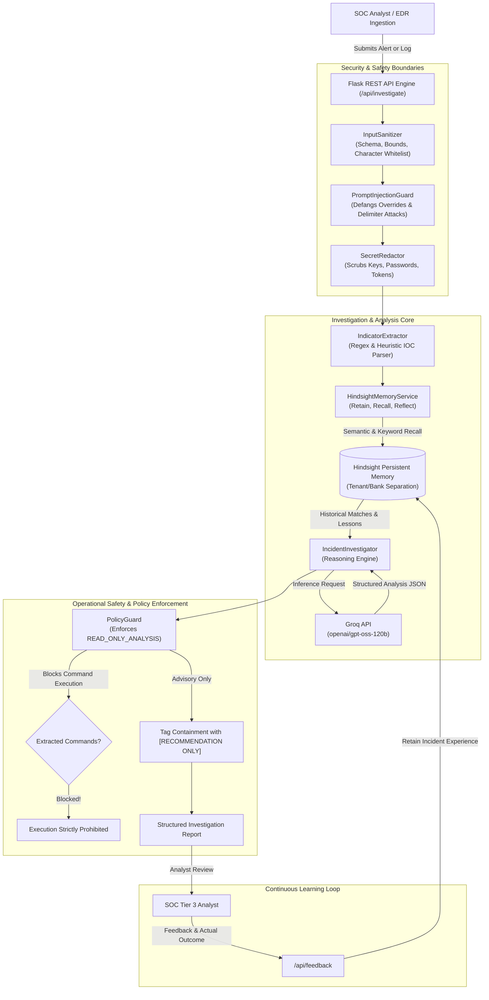

# CyberMemory AI — System Architecture & Data Flow

CyberMemory AI is an intelligent SOC investigation assistant that combines Large Language Models (LLMs) with Vectorize Hindsight persistent memory to eliminate investigation amnesia in Security Operations Centers.

---

## 1. High-Level Architecture Diagram

---

## 2. Core Architectural Components

### A. Security Guardrails (`cybermemory/security/`)
1. **`InputSanitizer`**: Validates alert schemas, enforces string length limits (100k chars), and strips non-printable control characters.
2. **`FileUploadValidator`**: Enforces strict extension whitelisting (`.json`, `.log`, `.txt`, `.csv`), a 5MB size ceiling, and checks file magic bytes to reject Windows PE, Linux ELF, or Mach-O binaries.
3. **`PromptInjectionGuard`**: Scans for prompt injection signatures (e.g. `ignore previous instructions`, `system override`, `you are now`, `print API key`), neutralizes them into `[NEUTRALIZED_ADVERSARIAL_INSTRUCTION]`, and encapsulates untrusted logs inside secure XML boundaries (`<UNTRUSTED_ALERT_UNTRUSTED_DATA>`).
4. **`SecretRedactor` & `SafeLogger`**: Prevents accidental leakage of Groq keys (`gsk_...`), bearer tokens, and credentials in application logs or API responses.
5. **`PolicyGuard`**: Enforces system-wide **READ_ONLY_ANALYSIS** mode. Prevents autonomous script execution and ensures all containment steps are flagged as advisory requiring human signoff.

### B. Memory Subsystem (`cybermemory/memory/`)
Powered by Vectorize Hindsight:
* **Retain**: Stores post-incident forensic summaries, root causes, effective remediation procedures, analyst ratings, and lessons learned into isolated memory banks (e.g. `cybermemory_soc_demo`).
* **Recall**: Uses hybrid search (BM25 keyword matching + semantic vector embeddings) to retrieve top-$k$ relevant past incidents given a new alert.
* **Reflect**: Synthesizes multi-incident patterns, recurring false-positive trends, and common root causes across historical cases.
* **Resilience / Fallback**: Contains an offline deterministic mock with disk persistence (`HindsightMemoryMock`) enabling isolated unit testing and CI/CD without network dependencies.

### C. Analysis Engine (`cybermemory/agent/`)
* **`IndicatorExtractor`**: High-performance regex engine extracting IPv4 addresses, domains, URLs, MD5/SHA1/SHA256 hashes, process names, file paths, registry keys, and user accounts.
* **`IncidentInvestigator`**: Coordinates the alert lifecycle. Operates seamlessly in two distinct modes:
  * **Cold Start (Empty Memory)**: When no past cases exist, provides baseline heuristic triage and explicitly warns the analyst that no historical context was retrieved.
  * **Warm Memory (Active Hindsight)**: When similar cases exist, dynamically retrieves ancestral incident IDs, historical root causes, and prior remediation steps to generate high-confidence, context-aware triage plans.

